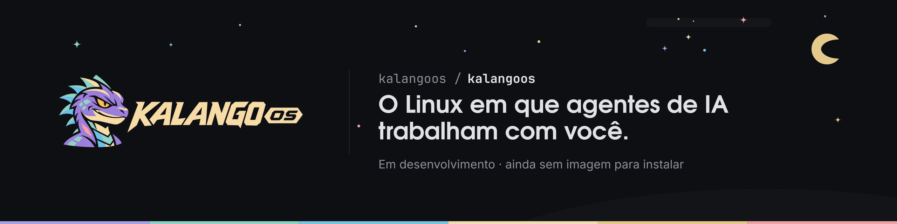

<p align="center">
  
</p>

<p align="center">
  
  
  
  
  <a href="https://github.com/kalangoos/kalangoos/actions/workflows/ci.yml"></a>
</p>

<p align="center">
  <a href="#o-que-é">O que é</a> ·
  <a href="#onde-estamos">Onde estamos</a> ·
  <a href="docs/NOTAS-0.1.0.md">Notas da 0.1.0</a> ·
  <a href="#como-é-feito">Como é feito</a> ·
  <a href="#rodar-a-sessão-de-desenvolvimento">Rodar</a> ·
  <a href="ROADMAP.md">Roteiro</a> ·
  <a href="CONTRIBUTING.md">Contribuir</a> ·
  <a href="#english">English</a>
</p>

> [!IMPORTANT]
> **O KalangoOS 0.1.0 é uma prévia técnica.** Há uma ISO instalável (x86_64, UEFI), montada e testada numa máquina
> virtual pela esteira de lançamento: a sessão ao vivo abre com o instalador, o motor do instalador grava num disco virtual vazio (a etapa gráfica "Modelos de IA" não é exercitada pelo teste) e o
> sistema instalado liga na sessão. Mas ela ainda não foi validada em hardware de verdade (a matriz NVIDIA, AMD e
> Intel está incompleta), então **não instale em um computador com dados que você não pode perder**: use uma
> máquina virtual ou um computador de teste. As limitações conhecidas estão em
> [docs/LANCAMENTO.md](docs/LANCAMENTO.md) e as notas da versão em [docs/NOTAS-0.1.0.md](docs/NOTAS-0.1.0.md).

## O que é

Uma distribuição Linux para computadores pessoais em que agentes de IA trabalham junto com você: entendem pedidos
em linguagem natural, operam o sistema e os apps, e tudo o que fazem fica visível, pede aprovação quando é
arriscado e pode ser desfeito.

- **Agentes que fazem, não só conversam.** Eles mexem no sistema de verdade pelo `kalangod`, um serviço próprio
  que fala o protocolo MCP, com quatro níveis de poder (observar, usuário, sistema, total).
- **Nada irreversível sem você.** Ações arriscadas pedem aprovação numa tela desenhada pelo sistema, que o agente
  não consegue imitar; cada ação entra na Linha do tempo, com desfazer e ponto de restauração.
- **Local por padrão.** O modelo padrão (LFM3, da Liquid AI) roda no seu computador pelo llama.cpp. Nuvem só com
  a sua permissão. A ISO da prévia não leva o modelo: o instalador (etapa "Modelos de IA") e a Central de Apps o
  baixam, de uma fonte que você escolhe (o catálogo público, um servidor privado ou uma pasta).
- **Regras impostas pelo kernel.** eBPF LSM, Landlock, seccomp e cgroups, sem módulo de kernel próprio. A ISO
  leva um kernel 7.3.4 compilado pelo projeto (configuração em `kernel/`); ele não recebe as atualizações do kernel do Ubuntu.
- **Um desktop próprio.** Shell em Rust e GTK 4 sobre o compositor [niri](https://github.com/YaLTeR/niri), apps
  do próprio sistema e um único Design System, nos temas escuro e claro.

## Onde estamos

| Frente | Situação na 0.1.0 |
|---|---|
| Imagem instalável (ISO) | Existe. A esteira de lançamento a monta, liga a sessão ao vivo numa VM, instala num disco virtual vazio e liga o sistema instalado; só então a anexa ao rascunho da versão |
| Instalador e primeiro uso | O motor do instalador grava num disco virtual vazio no teste da esteira; as telas, inclusive a etapa "Modelos de IA" (catálogo público, servidor privado ou pasta), existem, mas o teste não as exercita |
| Shell e niri com patches (barra, dock, barras laterais, área de trabalho, bloqueio, janelas e espaços) | Funcionam, com testes automáticos na sessão e na VM |
| Apps do sistema (Arquivos, Configurações, Terminal, Editor, Calculadora, Central de agentes…) | Vários prontos; outros em andamento ([docs/telas.md](docs/telas.md)) |
| `kalangod` (aprovação, desfazer, Linha do tempo, níveis de poder) | Funciona; as regras do kernel (eBPF LSM, Landlock, seccomp, cgroups) valem com o kernel do KalangoOS |
| Agentes locais (`kalango-agente`, LFM3 via llama.cpp) e gestão de contexto | Funcionam; o modelo de decisão d1 (opcional, baixado à parte) responde nos blocos "Decidir" dos Fluxos e recomenda na tela de aprovação; aprovar sozinho o que é de baixo risco é opcional e vem desligado |
| Kalango Remote e Kalango Audio | Vêm na ISO (repositórios próprios, em commits fixos). O Remote tem senha fixa, duas etapas, gravação, servidor próprio e modo de privacidade; ainda não foi testado entre dois computadores físicos nem numa sessão real (não aninhada) do niri; o Mosh não foi testado; o caminho da tela de bloqueio e o quadro de transição sob a cobertura do modo de privacidade só são cobertos pelo código, não por um teste |
| Kalango VirtualDesk e Kalango Fluxos | Repositórios próprios, **fora da ISO** da prévia: o `kalangod` já tem as ferramentas `vm.*` e o shell tem as telas (Sandbox, editor de fluxo); o serviço de fluxos é de um repositório privado |
| Hardware real, acessibilidade, inglês | **Pendentes**: matriz de hardware incompleta, sem certificação de acessibilidade, interface só em português |

## Como é feito

```text
crates/
  kalango-shell/        o desktop inteiro: barra, dock, barras laterais, apps do sistema, Central de agentes
  kalangod/             o "MCP do sistema": serviço privilegiado com regras no kernel (eBPF, Landlock, cgroups)
  kalango-agente/       o motor dos agentes (llama.cpp + LFM3 local), fala com o kalangod
  kalango-aprovacao/    a tela de aprovação, desenhada fora do alcance dos agentes
  kalango-entrada/      a tela de entrada (greetd)
  kalango-instalador/   o instalador
  kalango-movimento/    as molas das animações
  kalango-i18n/         as traduções (pt-BR hoje)
sessao/                 a sessão: niri, patches do niri, arquivos da imagem, suíte de testes da sessão
design/tokens/          cores, movimento e medidas exportados do Design System
openspec/               a especificação, fase por fase
docs/                   visão, arquitetura, segurança, requisitos, plano
```

As decisões e os motivos estão em [docs/ARQUITETURA.md](docs/ARQUITETURA.md); o modelo de ameaças em
[docs/SEGURANCA.md](docs/SEGURANCA.md).

## Rodar a sessão de desenvolvimento

Testado no Ubuntu 24.04. Nada é instalado no sistema: as dependências que o Ubuntu não tem vão para `poc/.deps`.

```sh
sudo apt install build-essential clang libbpf-dev pkg-config libgtk-4-dev libvte-2.91-gtk4-dev \
  libpoppler-glib-dev libgstreamer1.0-dev libgstreamer-plugins-base1.0-dev   # bibliotecas de desenvolvimento
poc/setup-deps.sh        # gtk4-layer-shell, Inter e o resto, em poc/.deps (sem sudo)
sessao/rodar.sh          # a sessão inteira numa janela (niri aninhado), kalangod em simulação
```

O niri com os patches do KalangoOS é montado por `sessao/niri/preparar.sh`. Os agentes precisam do llama.cpp e do
modelo LFM3 (veja [docs/ARQUITETURA.md](docs/ARQUITETURA.md), decisão D6). Detalhes em
[sessao/README.md](sessao/README.md).

Testes:

```sh
cargo test --workspace --exclude kalango-agente   # o que a CI roda
cargo test -p kalango-agente                      # inclui os testes com o modelo local de verdade
sessao/testar.sh                                  # a suíte da sessão (niri aninhado, ~25 min)
```

## Contribuir

Leia o [CONTRIBUTING.md](CONTRIBUTING.md). Agentes de código (Claude Code, Codex e outros) seguem o
[AGENTS.md](AGENTS.md). Falhas de segurança: [SECURITY.md](SECURITY.md), nunca em issue pública.

## Licença

O código do KalangoOS é software livre sob a **GNU General Public License, versão 3 ou posterior**
([LICENSE](LICENSE), `GPL-3.0-or-later`). O nome KalangoOS, o mascote e os logos são a marca do projeto e ficam fora
dessa licença ([LICENSE-brand.txt](LICENSE-brand.txt)). Recursos de terceiros: [ATTRIBUTION.md](ATTRIBUTION.md) e
[NOTICE](NOTICE).

---

## English

**KalangoOS is a Linux distribution where AI agents work alongside you:** they understand plain-language requests
and operate the system and its apps, and everything they do is visible, asks for approval when it is risky, and
can be undone.

> [!IMPORTANT]
> **KalangoOS 0.1.0 is a technical preview.** There is an installable ISO (x86_64, UEFI), built and tested in a
> virtual machine by the release workflow: the live session boots with the installer, the installer engine writes to an
> empty virtual disk (the graphical "AI models" step is not exercised by the test) and the installed system boots into its session. It has not been validated on real hardware yet (the
> NVIDIA, AMD and Intel matrix is incomplete), so use a virtual machine or a test computer, not one with data you
> cannot lose. See [docs/NOTAS-0.1.0.md](docs/NOTAS-0.1.0.md) for the release notes and known limitations.

- **Agents that act.** They operate the system through `kalangod`, our privileged service that speaks MCP, with
  four power levels and kernel-enforced rules (eBPF LSM, Landlock, seccomp, cgroups; no out-of-tree module).
- **Nothing irreversible without you.** Risky actions ask for approval on a screen drawn by the system; every action
  goes to an undoable timeline.
- **Local first.** The default model (Liquid AI's LFM3) runs on your machine through llama.cpp. The preview ISO
  does not ship a model: the installer's "AI models" step and the app center download it from a source you choose.
- **Its own desktop.** A Rust and GTK 4 shell on the [niri](https://github.com/YaLTeR/niri) compositor, with the
  system's own apps and one design system.

The docs and the UI are in Brazilian Portuguese first; English comes next ([ROADMAP.md](ROADMAP.md), phase 6).
Build and run steps are above (to try the ISO in a VM, see [docs/NOTAS-0.1.0.md](docs/NOTAS-0.1.0.md)); contributions are welcome in Portuguese or English ([CONTRIBUTING.md](CONTRIBUTING.md)).
The code is licensed under the GNU GPL, version 3 or later ([LICENSE](LICENSE)); the KalangoOS name, mascot and
logos are the project's brand and are not covered by it ([LICENSE-brand.txt](LICENSE-brand.txt)).
